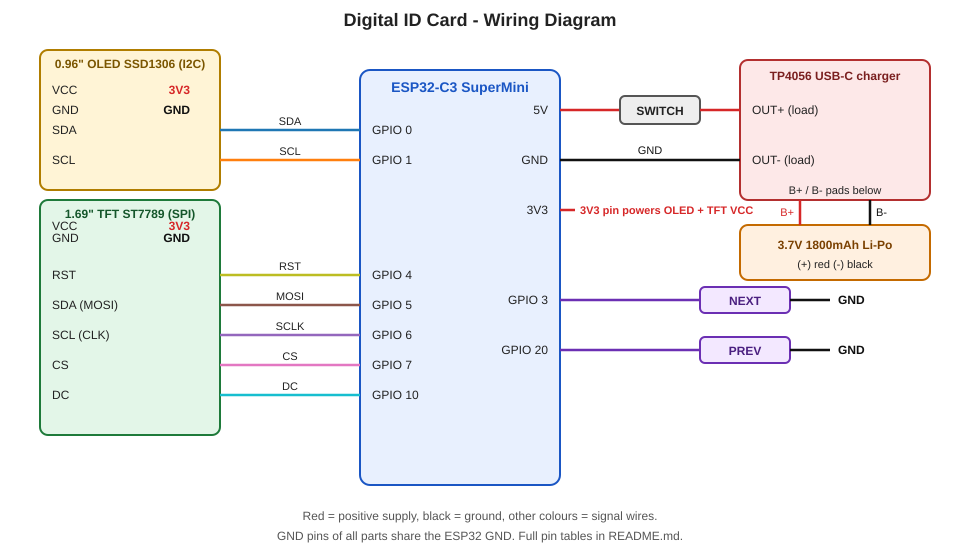

# Digital ID Card (ESP32-C3 + TFT + OLED)

A pocket-sized, battery-powered digital ID card. A 1.69" color TFT plays your animation (GIF) and shows still photos, while a small OLED scrolls your name, role or handle. Two push buttons switch between screens.

- **Main display:** 240 x 280 ST7789 TFT. It plays a GIF stored as JPEG frames, then shows still images.
- **Side display:** 128 x 64 SSD1306 OLED. It shows scrolling text and a caption for each screen.
- **Buttons:** NEXT and PREVIOUS cycle through the animation and the images.
- **Power:** a Li-Po battery, a USB-C TP4056 charger and an ON/OFF switch.



A printable PDF version of this guide is in [docs/Digital-ID-Card-Guide.pdf](docs/Digital-ID-Card-Guide.pdf).

## Contents

1. [Parts list](#1-parts-list)
2. [Wiring guide](#2-wiring-guide)
3. [Software setup](#3-software-setup)
4. [Using your own images and GIF](#4-using-your-own-images-and-gif)
5. [Customising the text](#5-customising-the-text)
6. [Project structure](#6-project-structure)
7. [Troubleshooting](#7-troubleshooting)

## 1. Parts list

| Part | Spec | Link |
| --- | --- | --- |
| Microcontroller | ESP32-C3 SuperMini (with soldered headers) | [Robu.in](https://robu.in/product/esp32-c3-development-board-with-soldering/) |
| Main display | SmartElex 1.69" ST7789 TFT, 240 x 280, SPI | [Robu.in](https://robu.in/product/smartelex-1-69-inch-tft-lcd-display/) |
| Side display | 0.96" SSD1306 OLED, 128 x 64, I2C | [Robu.in](https://robu.in/product/0-96-inch-yellow-yellow-blue-oled-lcd-led-display-module/) |
| Battery | 3.7 V 1800 mAh Li-Po | [Amazon](https://amzn.in/d/060XRVto) |
| Charger | TP4056 USB-C module with protection | [Robocraze](https://robocraze.com/products/tp4056-battery-charger-c-type-module-with-protection-1) |
| Power switch | SPST ON/OFF switch | any |
| Buttons | 2 x tactile push buttons | any |
| Wire | hook-up wire, soldering iron | |

> The links are the ones used to build this project. Any equivalent part with the same chip and pinout works.

## 2. Wiring guide

All display and button wiring is **7 signal wires for the displays plus 2 for the buttons**. Both displays share 3.3 V and GND.

### 2.1 TFT display (ST7789, SPI)

| TFT pin | ESP32-C3 pin |
| --- | --- |
| VCC | 3V3 |
| GND | GND |
| SCL / CLK | GPIO 6 |
| SDA / MOSI | GPIO 5 |
| CS | GPIO 7 |
| DC | GPIO 10 |
| RST | GPIO 4 |

If your TFT has a BL (backlight) pin, connect it to 3V3 too.

### 2.2 OLED display (SSD1306, I2C)

| OLED pin | ESP32-C3 pin |
| --- | --- |
| VCC | 3V3 |
| GND | GND |
| SDA | GPIO 0 |
| SCL | GPIO 1 |

The sketch expects the I2C address `0x3C`, which is what most modules use.

### 2.3 Buttons

Each button connects between a GPIO pin and GND. No resistor is needed because the firmware turns on the internal pull-up.

| Button | Pin A | Pin B |
| --- | --- | --- |
| NEXT | GPIO 3 | GND |
| PREVIOUS | GPIO 20 | GND |

### 2.4 Battery, charger and power switch

| From | To |
| --- | --- |
| Battery red (+) | TP4056 **B+** |
| Battery black (-) | TP4056 **B-** |
| TP4056 **OUT+** | one side of the power switch |
| Other side of the power switch | ESP32-C3 **5V** pin |
| TP4056 **OUT-** | ESP32-C3 **GND** |

Charge the battery through the TP4056 USB-C port. The switch cuts power to the whole card, and you can charge with the switch on or off.

**Read before you power it on:**

- A charged Li-Po is about 4.2 V. **Do not connect it to the ESP32 3V3 pin**, which is a 3.3 V rail and can be damaged. Use the **5V** pin, which goes through the board's onboard 3.3 V regulator.
- Double-check polarity. Reversing the battery or the charger output can destroy the parts.
- The TP4056 "OUT" pads and the "B" pads are different. The battery goes on **B+ / B-**. The load (switch and ESP32) goes on **OUT+ / OUT-**.
- Use a battery with a built-in protection circuit, or a TP4056 module that has protection (the module in the parts list does).
- Never short a Li-Po, and do not leave it charging unattended.

### 2.5 Full pin reference

| ESP32-C3 pin | Connected to |
| --- | --- |
| 5V | Power switch (from TP4056 OUT+) |
| 3V3 | TFT VCC, OLED VCC |
| GND | TFT GND, OLED GND, both buttons, TP4056 OUT- |
| GPIO 0 | OLED SDA |
| GPIO 1 | OLED SCL |
| GPIO 3 | NEXT button |
| GPIO 4 | TFT RST |
| GPIO 5 | TFT SDA (MOSI) |
| GPIO 6 | TFT SCL (CLK) |
| GPIO 7 | TFT CS |
| GPIO 10 | TFT DC |
| GPIO 20 | PREVIOUS button |

These pins are defined at the top of [DigitalIdCard.ino](firmware/DigitalIdCard/DigitalIdCard.ino) if you want to change them.

## 3. Software setup

### 3.1 Install the tools

1. Install the [Arduino IDE](https://www.arduino.cc/en/software).
2. Add ESP32 board support: **File > Preferences > Additional boards manager URLs**, add
   `https://espressif.github.io/arduino-esp32/package_esp32_index.json`, then install **esp32 by Espressif Systems** from the Boards Manager.
3. Install these libraries from the Library Manager:
   - Adafruit GFX Library
   - Adafruit ST7735 and ST7789 Library
   - Adafruit SSD1306
   - JPEGDEC (by Larry Bank)

### 3.2 Upload the firmware

1. Open `firmware/DigitalIdCard/DigitalIdCard.ino`.
2. Select **Tools > Board > esp32 > ESP32C3 Dev Module**.
3. Set these options:
   - USB CDC On Boot: **Enabled** (needed for Serial Monitor output)
   - Partition Scheme: **Huge APP (3MB No OTA/1MB SPIFFS)**. A long animation needs the extra flash.
   - Flash Size: 4MB
4. Plug in the board over USB-C, select its port and click **Upload**.

If the board is not detected, hold the **BOOT** button while plugging it in, then upload.

The sketch ships with neutral sample content (a 12-frame animation and two gradient images), so it runs straight away. Next, make it yours.

You can also build from the command line with `arduino-cli`. The board settings are saved in `firmware/DigitalIdCard/sketch.yaml`.

## 4. Using your own images and GIF

The ESP32 can't read PNG or GIF files directly. Two Python scripts in [tools/](tools) convert them into C header files that are compiled into the firmware.

### 4.1 Install the converters

You need Python 3.8+.

```bash
pip install -r tools/requirements.txt
```

### 4.2 Convert a GIF (the animation screen)

```bash
python tools/gif_to_header.py my_animation.gif firmware/DigitalIdCard/animation.h
```

Options:

| Option | Default | What it does |
| --- | --- | --- |
| `--quality` | 75 | JPEG quality (1-95). Lower numbers give a smaller file. |
| `--slowdown` | 1.0 | Playback time multiplier. 2.0 plays twice as slow. |

The script scales and center-crops every frame to 240 x 280, compresses each as a JPEG, and writes them with their timings into `animation.h`. The output size is printed when it finishes. Everything must fit in the ESP32-C3 flash (about 3 MB with the Huge APP partition), so if the upload fails with "sketch too big", reduce the number of frames, the GIF size or `--quality`.

### 4.3 Convert still images

```bash
python tools/image_to_header.py my_photo.png firmware/DigitalIdCard/image_one.h --name imageOne
python tools/image_to_header.py my_photo2.png firmware/DigitalIdCard/image_two.h --name imageTwo
```

Each image is scaled and center-cropped to 240 x 280 and stored as raw RGB565 (about 130 KB each). `--name` sets the array name, which becomes `<name>Data` (for example `imageOneData`).

### 4.4 Add a third image

1. Convert it: `python tools/image_to_header.py photo3.png firmware/DigitalIdCard/image_three.h --name imageThree`
2. In `DigitalIdCard.ino`, add `#include "image_three.h"`.
3. Add `imageThreeData` to the `images[]` array.
4. Add one matching line to `scrollingTexts[]` and `mainTexts[]`. Each screen needs an entry in both.

### 4.5 Re-upload

After converting, upload the sketch again from the Arduino IDE.

Sample files are in [assets/](assets) (`sample.gif`, `sample_image_1.png`, `sample_image_2.png`) so you can test the converters first. `tools/make_samples.py` regenerates them.

## 5. Customising the text

Open `DigitalIdCard.ino` and edit the **USER SETTINGS** block at the top:

```cpp
const char *const scrollingTexts[] = {
  "@your.handle \x07 Your Role \x07 Maker",   // screen 0: animation
  "@your.handle \x07 Your Name \x07 Maker",   // screen 1: image one
  "@your.handle \x07 Your Role \x07 Your Name" // screen 2: image two
};

const char *const mainTexts[] = { "Name", "Role", "Maker" };

#define SCROLL_INTERVAL 25   // ms per pixel, lower = faster
```

- `\x07` prints a bullet in the OLED font. A typed bullet character shows up as garbage.
- Keep the big caption (`mainTexts`) to about 7 characters. It is drawn at 12 px per character on a 128 px wide screen.

### Controls

| Action | Result |
| --- | --- |
| Press NEXT | Go to the next screen (animation > image 1 > image 2 > animation ...) |
| Press PREVIOUS | Go to the previous screen |

## 6. Project structure

```
.
├── README.md
├── assets/
│   ├── sample.gif                  sample animation
│   ├── sample_image_1.png          sample still images
│   └── sample_image_2.png
├── docs/
│   ├── circuit_diagram.svg         wiring diagram
│   ├── Digital-ID-Card-Guide.pdf   printable guide
│   └── guide/guide.html            source of the PDF
├── firmware/
│   └── DigitalIdCard/
│       ├── DigitalIdCard.ino       main sketch (open this in Arduino IDE)
│       ├── sketch.yaml             arduino-cli board settings
│       ├── animation.h             generated: animation frames
│       ├── image_one.h             generated: still image 1
│       └── image_two.h             generated: still image 2
└── tools/
    ├── gif_to_header.py            GIF -> animation.h
    ├── image_to_header.py          image -> still image header
    ├── make_samples.py             regenerates assets/
    ├── build_guide_pdf.py          rebuilds the PDF (needs Chrome or Edge)
    └── requirements.txt
```

## 7. Troubleshooting

| Problem | Likely cause and fix |
| --- | --- |
| TFT stays black | Re-check the 5 SPI wires (RST, SDA, SCL, CS, DC) and VCC/GND. Some TFT modules also need BL tied to 3V3. |
| TFT colors look wrong or the picture is shifted | Make sure it is a 240 x 280 ST7789 and that the sketch calls `tft.init(240, 280)`. |
| Serial Monitor says `OLED not found!` | Check SDA/SCL (GPIO 0/1). Some modules use address `0x3D`, so change `OLED_ADDRESS` in the sketch. |
| Nothing prints in the Serial Monitor | Set **USB CDC On Boot** to Enabled and use 115200 baud. |
| "Sketch too big" | Set the Huge APP partition, then shrink the GIF with fewer frames, a smaller size or lower `--quality`. |
| Animation plays too fast or slow | Use `--slowdown` with `gif_to_header.py`. |
| Button does nothing or jumps two screens | Check that it connects the GPIO to GND. Debounce time is `DEBOUNCE_MS`. |
| Card does not turn on from the battery | Check battery polarity on B+/B-, the switch, and that OUT+ goes through the switch to the **5V** pin. |
| Upload fails | Hold BOOT while plugging in USB, try another cable (some are charge-only), or lower the upload speed. |

## License

Released under the [MIT License](LICENSE).
